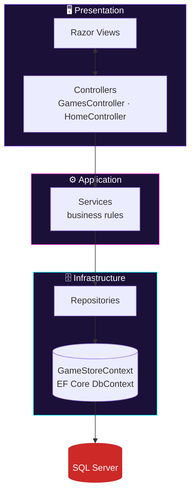
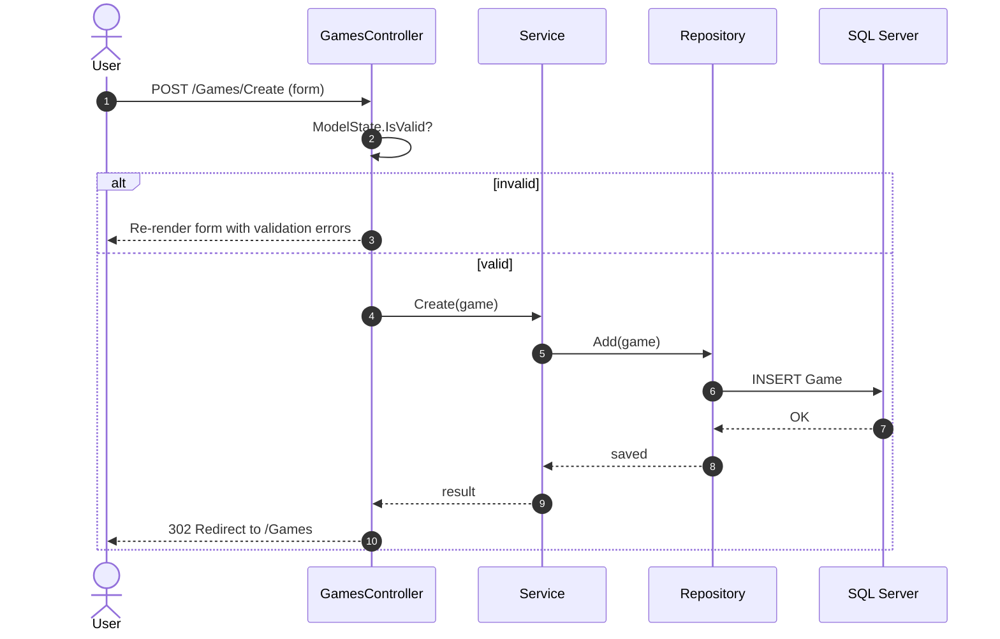
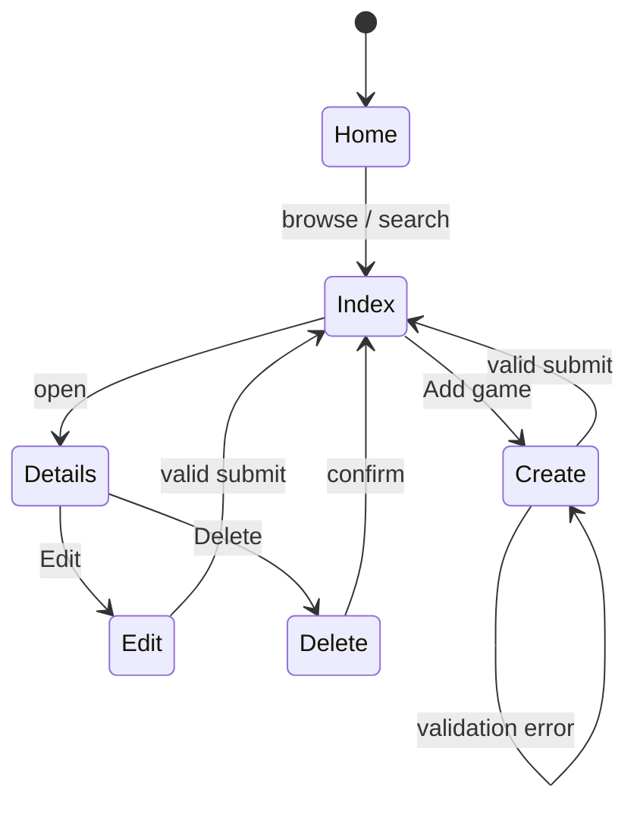
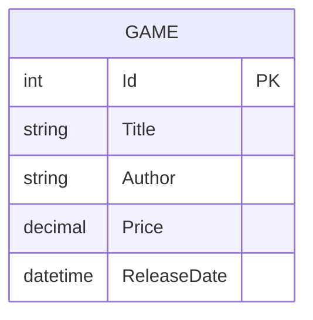
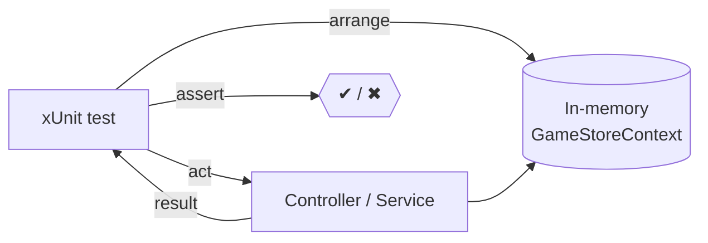
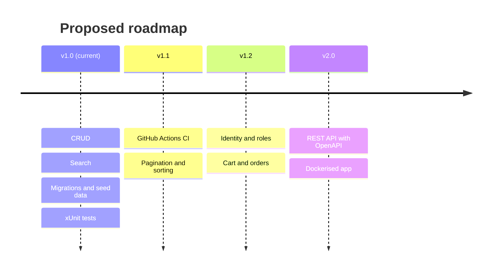
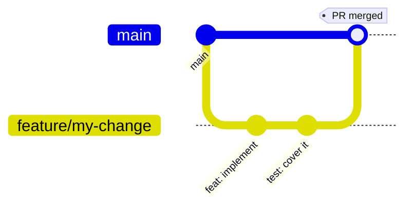

<div align="center">


<br/>

[](https://github.com/MIhajloS07/PixelMarketplace-aspnetcore/actions/workflows/ci.yml)


[](https://opensource.org/licenses/MIT)

[](https://github.com/MIhajloS07/PixelMarketplace-aspnetcore/stargazers)
[](https://github.com/MIhajloS07/PixelMarketplace-aspnetcore/network/members)

<br/>

[](#-quick-start)
[](#-architecture)
[](#-design-decisions)
[](#-testing--ci)
[](#-roadmap)

</div>


## 📑 Table of Contents

<details open>
<summary><b>Click to collapse</b></summary>

1. [Overview](#-overview)
2. [Features](#-features)
3. [Tech Stack](#-tech-stack)
4. [Quick Start](#-quick-start)
5. [Architecture](#-architecture)
6. [Design Decisions](#-design-decisions)
7. [Data Model](#-data-model)
8. [Configuration](#-configuration)
9. [Database & Migrations](#-database--migrations)
10. [Routes](#-routes)
11. [Testing & CI](#-testing--ci)
12. [Security Posture](#-security-posture)
13. [Performance Notes](#-performance-notes)
14. [Project Structure](#-project-structure)
15. [Screenshots](#-screenshots)
16. [Troubleshooting](#-troubleshooting)
17. [Roadmap](#-roadmap)
18. [Contributing](#-contributing)
19. [FAQ](#-faq)
20. [License](#-license)

</details>

---

## 🎮 Overview

**PixelMarketPlace** is a compact, end‑to‑end **ASP.NET Core MVC** application for managing a catalogue of video games. It is small enough to read in an afternoon, yet it exercises the whole engineering loop: layered design, a relational database with **EF Core migrations**, seeded demo data that works out of the box, validation on both client and server, and a unit test suite that runs against an **in‑memory database**.

> 💡 Use it as a learning project, a portfolio piece, or a starting template for CRUD‑style MVC applications.

### At a glance

| | |
|---|---|
| **Runtime** | .NET 10 / ASP.NET Core MVC |
| **Pattern** | MVC + Service + Repository |
| **Persistence** | EF Core, code‑first migrations, SQL Server (swappable provider) |
| **UI** | Razor views, Bootstrap, jQuery Unobtrusive Validation |
| **Tests** | xUnit + EF Core In‑Memory provider |
| **CI** | GitHub Actions (restore → build → test → coverage artifact) |
| **License** | MIT |

---

## ✨ Features

| | Feature | What you get |
|---|---|---|
| 🧩 | **Full CRUD** | Create, read, update and delete `Game` entities |
| 🔎 | **Search** | Find games by title or author from the Home and Index pages |
| 🌱 | **Seeded demo data** | The app shows content right after migrations are applied |
| ✅ | **Dual validation** | Server‑side (data annotations) plus client‑side (unobtrusive validation) |
| 🗃️ | **EF Core migrations** | Versioned schema, one‑command setup, easy reset |
| 🧪 | **Unit tests** | Controllers and model behaviour, fast in‑memory provider |
| 📱 | **Responsive UI** | Bootstrap views: Home, Index, Create, Edit, Details, Delete, Privacy |
| 🤖 | **CI workflow** | Build and test on every push and pull request |

---

## 🧰 Tech Stack

<div align="center">

</div>

| Layer | Technology |
|---|---|
| Framework | **.NET 10**, ASP.NET Core MVC |
| Data access | **Entity Framework Core** (SQL Server by default) |
| UI | Razor Views, **Bootstrap**, jQuery Unobtrusive Validation |
| Testing | **xUnit**, EF Core In‑Memory provider |
| Tooling | `dotnet-ef` CLI, GitHub Actions |

---

## ⚡ Quick Start

<div align="center">

</div>

### Prerequisites

| Requirement | Notes |
|---|---|
| [.NET 10 SDK](https://dotnet.microsoft.com/download) | Required |
| SQL Server, SQL Express or LocalDB | Or change the provider in `Program.cs` |
| `dotnet-ef` | Needed for migrations |

```bash
dotnet tool install --global dotnet-ef
```

### Run it

```bash
git clone https://github.com/MIhajloS07/PixelMarketplace-aspnetcore.git
cd PixelMarketplace-aspnetcore

dotnet restore
dotnet ef database update
dotnet run
```

Open the URL printed in the console (typically `https://localhost:5001`) and go to the **Games** section. 🎉

> ⚡ **One‑liner:** `dotnet restore && dotnet ef database update && dotnet run`

<details>
<summary><b>🐳 No SQL Server installed? Run one in Docker</b></summary>
<br/>

```bash
docker run -e "ACCEPT_EULA=Y" -e "MSSQL_SA_PASSWORD=Your_strong_Passw0rd" \
  -p 1433:1433 --name pixel-sql -d mcr.microsoft.com/mssql/server:2022-latest
```

Then point the connection string at it, preferably via User Secrets so the password never touches Git:

```bash
dotnet user-secrets init
dotnet user-secrets set "ConnectionStrings:GameStoreContext" \
  "Server=localhost,1433;Database=PixelMarketPlaceDB;User Id=sa;Password=Your_strong_Passw0rd;TrustServerCertificate=True"
dotnet ef database update
```
</details>

---

## 🏗️ Architecture

<div align="center">

</div>

### Layers and dependency direction



Dependencies only point **downwards**: a controller never talks to the `DbContext` directly, and the data layer knows nothing about HTTP.

### Creating a game: end to end



### Typical ASP.NET Core pipeline

> The exact order lives in `Program.cs`; this is the usual shape of an MVC app.


### Screen flow



<details>
<summary><b>🖼️ Original architecture diagram</b></summary>
<br/>


*Diagram created by Mihajlo.*
</details>

---

## 🧠 Design Decisions

Short, ADR‑style notes: what was chosen, why, and what it costs.

| # | Decision | Why | Trade‑off |
|---|---|---|---|
| 1 | **MVC with server‑rendered Razor** | Simple mental model, great fit for CRUD, no SPA build chain | Less interactive than a SPA; full page loads |
| 2 | **Service + Repository layers** | Keeps controllers thin and business rules testable in isolation | Extra indirection for a small domain |
| 3 | **EF Core code‑first migrations** | Schema is versioned with the code and reproducible | Migrations must be added whenever the model or seed data changes |
| 4 | **Seed data in `OnModelCreating`** | App is useful immediately after `database update` | Changing seed data requires a new migration |
| 5 | **Data annotations + unobtrusive validation** | One source of truth for rules, instant client feedback | Complex cross‑field rules need custom validators |
| 6 | **In‑memory provider for tests** | Fast, no external dependencies, easy CI | Does not enforce relational constraints or SQL translation; see the [FAQ](#-faq) |
| 7 | **Connection string via config / env / secrets** | No credentials in the repository | Each developer must configure their own |

---

## 🗂️ Data Model



<details>
<summary><b>🖼️ Seeded data preview</b></summary>
<br/>


*Query results from the development database showing seeded records (Id, Title, Author, Price, ReleaseDate).*
</details>

---

## ⚙️ Configuration

Edit `appsettings.json` and set `ConnectionStrings:GameStoreContext`:

```json
{
  "ConnectionStrings": {
    "GameStoreContext": "Server=.\\SQLEXPRESS;Database=PixelMarketPlaceDB;Trusted_Connection=True;MultipleActiveResultSets=true;TrustServerCertificate=True"
  }
}
```

| Environment | Recommended approach |
|---|---|
| Local development | LocalDB / SQL Express, or [User Secrets](https://learn.microsoft.com/aspnet/core/security/app-secrets) |
| CI / Production | Environment variables or a secrets manager |

Override with an environment variable (double underscore replaces `:`):

```bash
export ConnectionStrings__GameStoreContext="Server=...;Database=PixelMarketPlaceDB;..."
```

> 🔐 **Never commit credentials** to the repository.

---

## 🗃️ Database & Migrations

Seed data lives in `GameStoreContext.OnModelCreating` and is inserted when migrations are applied.

| Task | Command |
|---|---|
| Apply migrations | `dotnet ef database update` |
| Add a migration | `dotnet ef migrations add <MigrationName>` |
| Reset the database | `dotnet ef database drop` then `dotnet ef database update` |
| Remove last (unapplied) migration | `dotnet ef migrations remove` |
| Generate an idempotent SQL script | `dotnet ef migrations script --idempotent -o migrate.sql` |

If you change the model or the seed data, add a new migration so the model snapshot stays in sync:

```bash
dotnet ef migrations add <MigrationName>
dotnet ef database update
```

---

## 🧭 Routes

| Method | Route | Purpose |
|---|---|---|
| `GET` | `/` | Home page with search |
| `GET` | `/Games` | List and search games |
| `GET` | `/Games/Details/{id}` | Game details |
| `GET` / `POST` | `/Games/Create` | Create a game |
| `GET` / `POST` | `/Games/Edit/{id}` | Edit a game |
| `GET` / `POST` | `/Games/Delete/{id}` | Delete a game |
| `GET` | `/Home/Privacy` | Privacy page |

---

## 🧪 Testing & CI

<div align="center">

</div>

```bash
dotnet test
```

- **Framework:** xUnit
- **Database:** EF Core In‑Memory provider, so no live database is needed
- **Scope:** controllers, services and model validation

Useful variants:

```bash
# verbose output
dotnet test --logger "console;verbosity=detailed"

# code coverage (requires the coverlet.collector package, included in the default xUnit template)
dotnet test --collect:"XPlat Code Coverage"
```

### Test strategy

| Level | Status | Tooling |
|---|---|---|
| Unit (controllers, services, validation) | ✅ Implemented | xUnit + In‑Memory EF |
| Integration (real SQL engine) | 🔜 Proposed | `WebApplicationFactory` + SQLite or Testcontainers |
| End‑to‑end (browser) | 🔜 Proposed | Playwright |



### Continuous integration

The workflow in [`.github/workflows/ci.yml`](.github/workflows/ci.yml) runs on every push and pull request to `main`:

1. Checkout
2. Setup .NET 10
3. `dotnet restore`
4. `dotnet build -c Release`
5. `dotnet test` with coverage, uploaded as a build artifact

---

## 🛡️ Security Posture

| Area | Status | Notes |
|---|---|---|
| SQL injection | ✅ Framework default | EF Core uses parameterised queries |
| XSS | ✅ Framework default | Razor HTML‑encodes output unless `Html.Raw` is used |
| Secrets | ✅ Convention | Kept out of the repo (User Secrets, env vars) |
| CSRF | 🔎 Verify | Form tag helpers emit anti‑forgery tokens; confirm `[ValidateAntiForgeryToken]` or `AutoValidateAntiforgeryToken` on POST actions |
| Over‑posting | 🔎 Verify | Bind only the intended properties (`[Bind]` or view models) |
| Transport | 🔜 Recommended | HTTPS redirection and HSTS in production |
| AuthN / AuthZ | 🔜 Planned | ASP.NET Core Identity, see [Roadmap](#-roadmap) |

---

## 🚀 Performance Notes

Recommendations for when the catalogue grows beyond a demo:

- Use `AsNoTracking()` for read‑only queries (list, details, search).
- Add database indexes on `Title` and `Author` if search becomes slow.
- Paginate the Index page instead of loading all rows.
- Keep `DbContext` scoped per request (the ASP.NET Core default).

---

## 📁 Project Structure

```text
PixelMarketPlace
├── .github/workflows/  # CI pipeline (ci.yml)
├── assets/             # Animated SVGs used by this README
├── Controllers/        # GamesController, HomeController
├── Models/             # Game entity (data annotations), view models
├── Data/               # GameStoreContext (DbContext), seed data
├── Migrations/         # EF Core migrations + model snapshot
├── Views/              # Razor views (Home, Games/*, Shared)
├── wwwroot/            # Static assets (css, js, images)
├── Tests/              # xUnit tests (controllers, services, validation)
├── Properties/         # launchSettings.json
├── Program.cs          # App bootstrap, DI, middleware pipeline
├── appsettings.json
├── appsettings.Development.json
├── LICENSE
└── README.md
```

---

## 📸 Screenshots

<div align="center">

| | |
|:---:|:---:|
|  |  |
|  |  |


</div>

---

## 🩺 Troubleshooting

<details>
<summary><b>❌ <code>dotnet ef</code> command not found</b></summary>

```bash
dotnet tool install --global dotnet-ef
# or update
dotnet tool update --global dotnet-ef
```
</details>

<details>
<summary><b>❌ Cannot connect to SQL Server</b></summary>

- Check the instance name in the connection string (`.\SQLEXPRESS`, `(localdb)\MSSQLLocalDB`, `localhost,1433`).
- Make sure the SQL Server service or container is running.
- For local development keep `TrustServerCertificate=True`.
</details>

<details>
<summary><b>❌ Pending model changes / snapshot out of sync</b></summary>

```bash
dotnet ef migrations add SyncModel
dotnet ef database update
```
</details>

<details>
<summary><b>❌ HTTPS certificate warning</b></summary>

```bash
dotnet dev-certs https --trust
```
</details>

<details>
<summary><b>❌ Seed data does not appear</b></summary>

Seed data is applied by migrations. After editing it, add a new migration and run `dotnet ef database update`, or reset with `dotnet ef database drop` followed by `dotnet ef database update`.
</details>

---

## 🛣️ Roadmap



- [x] Full CRUD for games
- [x] Search by title and author
- [x] EF Core migrations and seed data
- [x] Unit tests with in‑memory provider
- [x] GitHub Actions CI workflow
- [ ] Pagination and sorting
- [ ] Authentication and roles (ASP.NET Core Identity)
- [ ] Shopping cart and orders
- [ ] Integration tests against a real SQL engine
- [ ] Docker / docker‑compose for the full stack
- [ ] REST API + Swagger / OpenAPI

---

## 🤝 Contributing

Contributions are welcome!



1. Fork the repository
2. Create a branch: `git checkout -b feature/my-change`
3. Commit using [Conventional Commits](https://www.conventionalcommits.org/)
4. Push and open a Pull Request

| Prefix | Use for |
|---|---|
| `feat:` | New functionality |
| `fix:` | Bug fixes |
| `test:` | Adding or updating tests |
| `docs:` | Documentation only |
| `refactor:` | Code change with no behaviour change |
| `chore:` | Tooling, dependencies, CI |

### Definition of Done

- [ ] Builds without warnings (`dotnet build -c Release`)
- [ ] `dotnet test` is green
- [ ] New behaviour has tests
- [ ] Migration added if the model or seed data changed
- [ ] No secrets committed
- [ ] README updated if setup or behaviour changed

For major changes, open an issue first to discuss them.

---

## ❓ FAQ

<details>
<summary><b>Can I use a database other than SQL Server?</b></summary>

Yes. Swap the EF Core provider package and the `UseSqlServer(...)` call in `Program.cs`, update the connection string, then regenerate migrations for the new provider.
</details>

<details>
<summary><b>Why does the test suite use the In‑Memory provider instead of SQLite?</b></summary>

It is the fastest and simplest option for unit tests. It does not enforce relational constraints or translate queries to SQL, so integration tests against SQLite (in‑memory mode) or a containerised SQL Server are listed in the roadmap.
</details>

<details>
<summary><b>Do the animations in this README run on GitHub?</b></summary>

Yes. They are plain SVG files in `assets/`, embedded with ``, so no JavaScript is involved. Users with reduced‑motion settings see static versions.
</details>

---

## 📄 License

Distributed under the **MIT License**. See [`LICENSE`](LICENSE) for details.


<div align="center">

**Made with ❤️ by [Mihajlo](https://github.com/MIhajloS07)**

⭐ If you like this project, give it a star!

</div>
